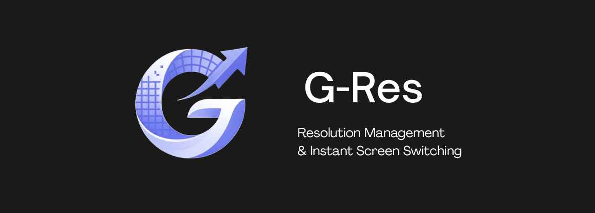

# G-Res
A tool for managing and switching display resolutions. It detects available monitor resolutions with their maximum refresh rates, allows quick resolution changes through a drop-down menu, and binds custom key combinations to switch to specific resolutions instantly.

  

## Interface

### Quick Switch
Quickly modify Windows resolution without compromising the highest available refresh rate.

### Hotkeys Manager
Assign a custom shortcut to automatically switch your display resolution, even while running a game, and use a dedicated hotkey to enable or disable the monitor directly.

### Settings
You can now change the program language, supporting 9 languages: English, Spanish, French, German, Mandarin Chinese, Hindi, and Arabic. Additionally, you have the option to select which screen you want the program changes to apply to, and you can enable 'Run with startup' from the settings tab to launch the app automatically with Windows.

## Features

* **Lightweight & Resource-Efficient:** Minimal CPU and RAM usage with zero performance impact.
* **Seamless Background Operation:** Runs quietly in the system tray for instant hotkey resolution switching.
* **Safe & Secure:** Built with clean, standard Windows APIs to ensure safe display adjustments without system conflicts.

## FAQ

* **Where can I download the latest version?**
You can head over to the [Releases](https://github.com/iiRG4/G-Res/releases) page and download the latest version to ensure the best experience and performance.

* **What Windows versions are supported?**
G-Res is fully compatible with **Windows 10** and **Windows 11**.

* **Does G-Res work while playing games in fullscreen?**
Yes, the hotkeys are global and will switch your resolution even while you are actively running a game.

* **How do I make the app start automatically with Windows?**
You can simply enable the **Run with startup** option directly from the settings tab.
